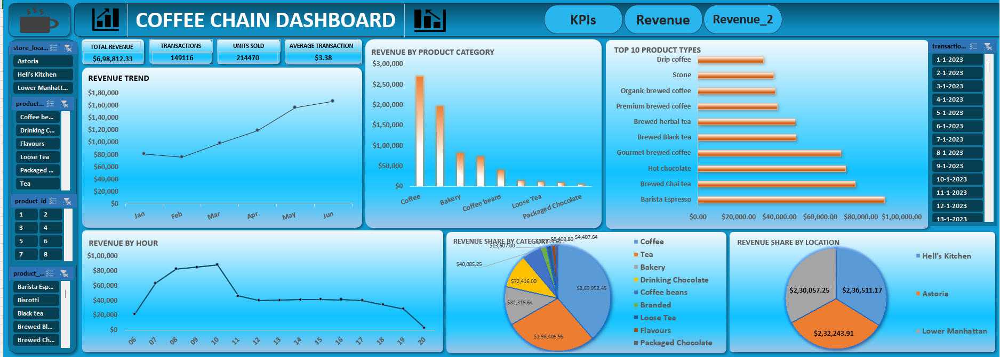

# Coffee-Chain-Dashboard
Exploratory sales analysis and dynamic BI dashboard tracking coffee chain revenue and performance trends in Microsoft Excel.

## Project Overview
This project analyzes sales and revenue performance for a coffee chain to answer key business questions:
- How do total revenue, transactions, and units sold trend across different months and time periods?
- Which product categories drive the highest revenue and volume?
- What hourly sales patterns and peak times stand out across operations?

The objective was to turn raw sales data into an interactive, easy-to-scan Microsoft Excel dashboard where stakeholders can dynamically filter metrics using slicers and timelines.

## Tools Used
- *Microsoft Excel*
  - *Pivot Tables & Pivot Charts:* Aggregated and visualized total revenue, transactions, units sold, monthly trends, product categories, and hourly sales patterns.
  - *Slicers & Timelines:* Added interactive filtering so viewers can slice the data by time and categories.
  - *Dashboard Design & Formatting:* Structured KPIs and charts with clean visual hierarchy and high contrast for quick readability.

## Key Insights
- *Total Revenue Benchmark:* Generated approximately *$6.98M* in total revenue across the dataset.
- *Monthly Revenue Trends:* Tracked month-over-month revenue fluctuations and peak periods using Pivot Charts and timeline filtering.
- *Product Category Performance:* Compared revenue and units sold across product categories to spotlight top-performing offerings vs. slower movers.
- *Hourly Sales Patterns:* Identified peak traffic hours and transaction concentration across the day to support staffing and inventory planning.

## Dashboard Preview

